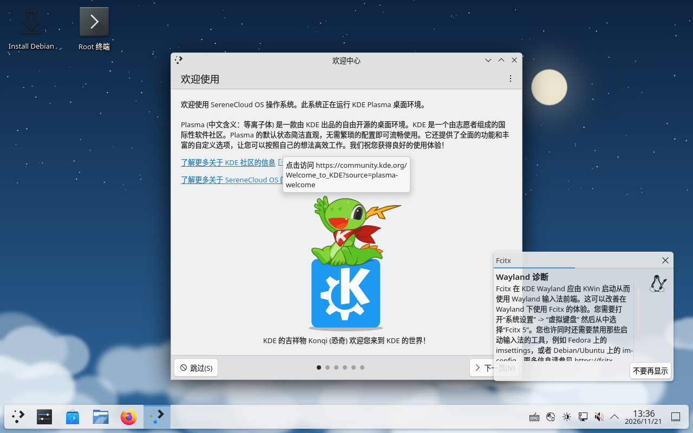

<p align="center">
  
</p>

<h1 align="center">SereneCloud OS · 云安</h1>

<p align="center">
  一个安静、好看、好用的电脑版 Linux 系统<br>
  基于 Debian 13 · KDE Plasma 6 · 作者：云安
</p>

<p align="center">
  <a href="https://github.com/ZW-SYS/SereneCloud-OS/releases"><b>⬇️ 下载最新版</b></a> ·
  <a href="#-功能介绍">功能介绍</a> ·
  <a href="#-安装方法">安装方法</a> ·
  <a href="https://github.com/ZW-SYS/SereneCloud-OS/issues">反馈问题</a>
</p>

---

## 👋 写在前面

**SereneCloud OS（云安 OS）是我基于 Linux 制作的第 1 个操作系统。**

我平时主要写安卓应用。这次想挑战一下更底层的东西，自己做一个从开机动画到桌面、从安装器到设置都带着自己风格的电脑系统。

名字里的 **“云安”** 是我的名字，也是这个系统想给人的感觉：像夜空里安静飘着的云，稳定、干净、让人安心。所以开机的时候，你会看到一朵朵云慢慢汇聚，最后变成 **SereneCloud** 这个名字。

它底层用的是以稳定出名的 **Debian**，桌面是功能很强的 **KDE Plasma**，在这之上我做了自己的主题、开机动画、权限设计和多用户体验。这是第一个预览版，还有很多想做的功能在路上，欢迎试用、提意见！

---

## 🎬 开机动画

云朵从四周飘来，慢慢汇聚，最后化成 **SereneCloud**：

<p align="center">
  
</p>

## 🖼️ 壁纸与主题

系统自带的「云安」壁纸：深蓝夜空、星点、一轮月亮和底下的云海。主题配色用的是 **云安蓝 `#4F8CC9`**，登录界面也用同一张背景。

<p align="center">
  
</p>

## 🖥️ 桌面

这是 v0.1.0 在虚拟机里自动开机后的真实截图：云安壁纸、桌面上的「Root 终端」、底部任务栏，欢迎中心里显示的就是 SereneCloud OS。

<p align="center">
  
</p>

---

## ✨ 功能介绍

### 已经有的（v0.1.0）

| | 功能 | 说明 |
|---|---|---|
| ☁️ | **专属开机动画** | 云朵汇聚成 SereneCloud，开机不再是黑屏滚代码 |
| 🎨 | **云安主题** | 自己的壁纸、配色、Logo，登录界面同款风格 |
| ℹ️ | **关于系统** | 设置里的「关于」页面显示 SereneCloud OS 云安、作者和本仓库 |
| 🔑 | **管理员免密 sudo** | 第一个用户自动成为管理员，用 sudo 不用每次输密码 |
| 🖥️ | **一键 Root 终端** | 桌面上就有，点一下打开最高权限终端（不需要用 root 账号登录，更安全） |
| 👥 | **多用户** | 在 设置 → 用户 里添加新用户（头像、密码），登录界面点头像就能切换，每人一个独立的桌面 |
| 💿 | **试用 + 安装** | U 盘启动直接进桌面试用，满意了再点「安装云安 OS」装到硬盘 |
| 📶 | **硬件支持广** | 自带全套固件：Intel / AMD / NVIDIA 显卡，Intel / Realtek / Atheros / Broadcom / MediaTek 无线网卡，声卡，蓝牙，CPU 微码 |
| 🀄 | **中文开箱即用** | 默认简体中文界面 + fcitx5 拼音输入法 |
| 📦 | **常用软件** | Firefox 浏览器、Dolphin 文件管理、Kate 编辑器、Okular 阅读器、Gwenview 看图、计算器、截图、分区工具、软件商店 |
| 🧪 | **每版都自动测试** | 每次构建都会在虚拟机里自动开机测试，并截图存档 |

### 正在做的

| 阶段 | 功能 |
|---|---|
| 2 | 更丰富的侧边栏和面板小部件、更完整的设置 |
| 2 | **内置代码运行器**：一个窗口选语言就能运行，支持 HTML/CSS/JS、Python、C、C++、Java、Node.js、Go、Rust、Shell，全部离线自带 |
| 2 | **Wine**：直接运行 Windows 的 .exe 程序 |
| 2 | 20 款常用软件安装 + 启动测试，保证稳定 |
| 3 | 一个小彩蛋 🥚 |
| 4 | 实验性：在电脑上运行安卓 APK |

---

## 💻 电脑要求

- 64 位电脑（x86_64），UEFI 和传统 BIOS 都能启动
- 内存：至少 4 GB（推荐 8 GB）
- 硬盘：至少 30 GB 空间
- 也可以装在 VirtualBox / VMware / QEMU 虚拟机里

---

## 📥 安装方法

1. **下载**：到 [Releases](https://github.com/ZW-SYS/SereneCloud-OS/releases) 下载 ISO。
   因为 GitHub 单个文件最大 2 GB，ISO 被切成了 `.part00`、`.part01` 两份，下载后先合并：
   - Windows（在下载文件夹打开命令提示符）：
     ```
     copy /b SereneCloud-OS-0.1.0-amd64.iso.part00 + SereneCloud-OS-0.1.0-amd64.iso.part01 SereneCloud-OS-0.1.0-amd64.iso
     ```
   - Linux / macOS：
     ```
     cat SereneCloud-OS-0.1.0-amd64.iso.part* > SereneCloud-OS-0.1.0-amd64.iso
     ```
2. **校验**（可选）：用 `SHA256SUMS` 里的值核对 ISO 有没有下坏。
3. **做启动 U 盘**：用 [Ventoy](https://www.ventoy.net)（推荐，把 ISO 拖进 U 盘就行）或 [balenaEtcher](https://etcher.balena.io)。
   想先在虚拟机里玩，就直接在 VirtualBox 里新建虚拟机、选这个 ISO。
4. **开机试用**：从 U 盘启动，会自动进入桌面。试用账户 `yunan`，不需要密码。
5. **安装**：双击桌面上的「安装云安 OS」，按提示一步步来。

> ⚠️ 目前是预览版，只在虚拟机里自动测试过。装到真电脑之前，请先用 U 盘试用模式确认 Wi-Fi、显卡、声音都正常，并备份好重要文件。

---

## 🛠️ 源码与自己构建

整个系统都是用配置和脚本“搭”出来的，全部源码都在这个仓库：

| 目录 | 内容 |
|---|---|
| `auto/config` | live-build 主配置（Debian 版本、启动方式、语言等） |
| `config/package-lists/` | 预装了哪些软件 |
| `config/includes.chroot/` | 直接放进系统里的文件：主题、开机动画、配置 |
| `config/hooks/` | 构建时运行的脚本：品牌、安装器、清理 |
| `branding/tools/gen_branding.py` | 用代码生成壁纸、Logo、开机动画每一帧 |
| `tests/boot-test.sh` | 在 QEMU 虚拟机里自动开机测试 |
| `.github/workflows/build-iso.yml` | GitHub Actions 自动构建、测试、发布 |

ISO 由 GitHub Actions 自动构建：推送到 `main` 会构建并测试，打 `v` 开头的标签就自动发布到 Releases。

本地构建（需要 Debian 13 或 Debian 容器，root 权限）：

```bash
sudo apt install live-build
sudo lb config && sudo lb build
```

修改品牌素材：`python3 branding/tools/gen_branding.py`（需要 Pillow）。

---

## 🙏 致谢

感谢 [Debian](https://www.debian.org)、[KDE](https://kde.org)、[Calamares](https://calamares.io) 以及所有自由软件的作者，没有你们就没有这个系统。

## 📄 许可证

本项目的代码和素材以 [GPL-3.0-or-later](LICENSE) 发布。系统中包含的 Debian 软件和非自由固件按各自的许可证分发。

<p align="center">Made with ☁️ by 云安</p>
