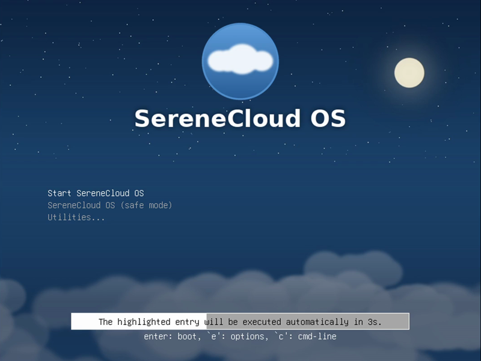

## SereneCloud OS 云安 v0.1.1 · 预览版

**这是我基于 Linux 制作的第 1 个操作系统！** 基于 Debian 13 (trixie) + KDE Plasma 6。作者：云安。

### 📺 演示视频
附件里的 **`SereneCloud-OS-demo.mp4`**（约 3 分钟）：从 U 盘开机菜单、云朵开机动画、桌面，到打开 Firefox、文件管理器、关于本系统、Root 终端、Kate 和安装器的完整过程，全程在虚拟机里自动录制。

### 这一版改了什么
- 🚀 U 盘开机菜单换成云安 OS 的名字和背景图（不再显示 Debian），**5 秒后自动启动**
- 💿 桌面安装图标从「Install Debian」改成「**安装云安 OS**」，换上云安图标
- ☁️ 开机动画的云朵边缘更柔和，飘进画面时不再被切成直边
- 🤫 开机后不再弹出 KDE 欢迎中心和输入法「Wayland 诊断」窗口，桌面清清爽爽
- 🎥 每次构建都会自动录制演示视频

### 已有功能
- ☁️ 开机动画：云朵从四周飘来，汇聚成 SereneCloud
- 🎨 云安壁纸、云安蓝配色、Logo，登录界面同款背景
- ℹ️ 「关于本系统」显示 SereneCloud OS 云安、作者和本仓库链接
- 🔑 第一个用户就是管理员，sudo 免密码；桌面上有一键「Root 终端」
- 👥 多用户：在 设置 → 用户 里添加（头像、密码），登录界面点头像切换各自的桌面
- 💿 试用 + 安装：U 盘启动直接进桌面试用，点「安装云安 OS」装到硬盘
- 📶 全套固件：Intel / AMD / NVIDIA 显卡，常见无线网卡、声卡、蓝牙，CPU 微码
- 🀄 默认简体中文 + fcitx5 拼音输入法；Firefox、Dolphin、Kate、Okular、Gwenview 等常用软件

### 下载
ISO 约 2.7 GB，超过了 GitHub 单个文件 2 GB 的上限，所以切成了 `.part00`、`.part01` 两份，下载后先合并：
- Windows：`copy /b SereneCloud-OS-0.1.1-amd64.iso.part00 + SereneCloud-OS-0.1.1-amd64.iso.part01 SereneCloud-OS-0.1.1-amd64.iso`
- Linux / macOS：`cat SereneCloud-OS-0.1.1-amd64.iso.part* > SereneCloud-OS-0.1.1-amd64.iso`

合并后用 `SHA256SUMS` 里的值校验。然后用 Ventoy / balenaEtcher 写入 U 盘，或在 VirtualBox / VMware 里打开。

**试用账户：** `yunan`，不需要密码。

源码就是本仓库，附件里也有 GitHub 自动打包的 Source code（zip / tar.gz）。

### ⚠️ 注意
这是早期预览版，只在 QEMU 虚拟机里自动测试过。装到真电脑之前，请先用 U 盘试用模式确认 Wi-Fi、显卡、声音正常；遇到问题欢迎提 [Issue](https://github.com/ZW-SYS/SereneCloud-OS/issues)。

### 下一版计划
更丰富的侧边栏和设置、内置代码运行器（离线自带 Python / C / C++ / Java / Node.js / Go / Rust 等）、Wine 运行 Windows 程序。
