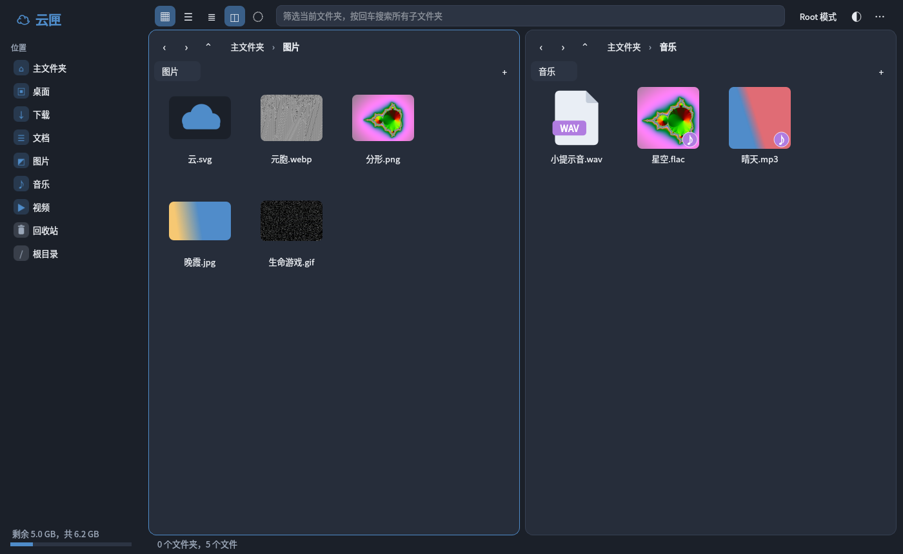

## SereneCloud OS 云安 v0.2.0

这是云安 OS 的第一个正式版！基于 Debian 13 (trixie) + KDE Plasma 6。作者：云安。

### 🆕 这一版新加了什么

**🥚 彩蛋：帮他们回家**

打开桌面上的「云安设置」，连续点 5 次「内核版本」，一盏灯会慢慢亮起来，出现「帮他们回家」。下面有两个入口：**公安部儿童失踪信息紧急发布平台（团圆）** 和 **宝贝回家寻子网**。云安 OS 只打开官方页面，不保存任何人的信息。**有线索请拨 110。**

附件里的 `SereneCloud-OS-easter-egg.mp4` 是彩蛋的演示视频。

**🗂️ 云匣（电脑版）文件管理**

我在安卓上做的云匣，现在有电脑版了，而且是云安 OS 默认的文件管理器：
- 深色界面，配云安蓝，好看不刺眼
- 左右两栏 + 多标签，拷文件很方便
- 图片、视频、PDF、歌曲封面、APK 图标都显示缩略图，一眼就知道是什么
- ZIP / 7z / RAR / TAR / APK / JAR 压缩包能像文件夹一样点进去
- 双击就能看图、看 PDF、看 Word / Excel / PPT、用阅读模式看 TXT 小说、预览 Markdown 和网页、编辑代码、播放视频

附件里的 `yunkit-*.png` 是云匣的截图。

### 📺 演示视频
- `SereneCloud-OS-demo.mp4`：从开机到桌面、打开软件的完整过程（虚拟机里自动录的）
- `SereneCloud-OS-easter-egg.mp4`：彩蛋演示

### 📥 下载
ISO 超过了 GitHub 单个文件 2 GB 的上限，所以切成了 `.part00`、`.part01` 两份，下载后先合并（方法和以前一样）：
- Windows：`copy /b SereneCloud-OS-0.2.0-amd64.iso.part00 + SereneCloud-OS-0.2.0-amd64.iso.part01 SereneCloud-OS-0.2.0-amd64.iso`
- Linux / macOS：`cat SereneCloud-OS-0.2.0-amd64.iso.part* > SereneCloud-OS-0.2.0-amd64.iso`

合并后可以用 `SHA256SUMS` 里的值校验。然后用 Ventoy / balenaEtcher 写入 U 盘，或者在 VirtualBox / VMware 里打开。

**试用账户：** `yunan`，不需要密码。

### ⚠️ 注意
我只在虚拟机里测试过，真电脑请自己测试。装到硬盘之前，先用 U 盘试用模式看看 Wi-Fi、显卡、声音正不正常，记得备份重要文件。有问题欢迎提 [Issue](https://github.com/ZW-SYS/SereneCloud-OS/issues)！

### 下一版计划
云匣音乐、APK 反编译和签名等逆向工具、内置代码运行器、Wine 运行 Windows 程序。
